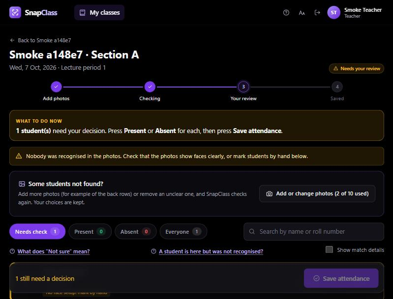
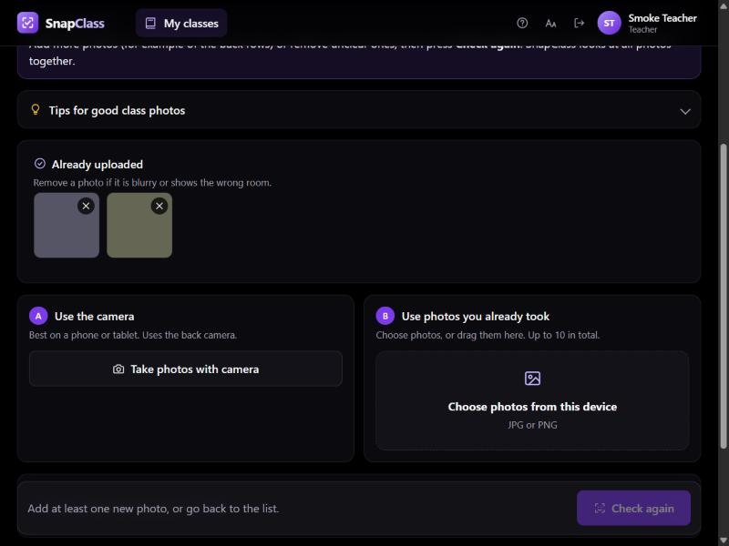
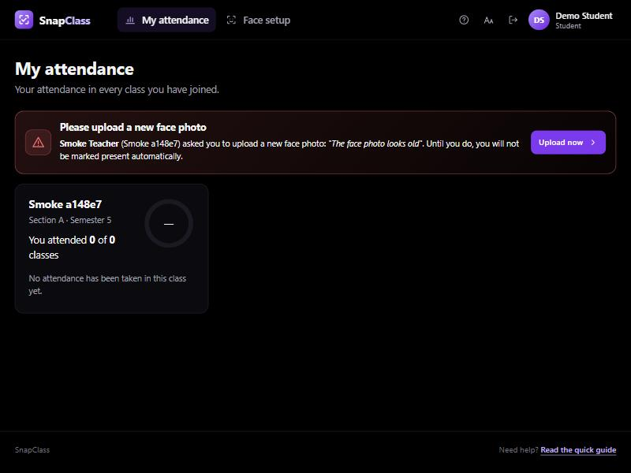
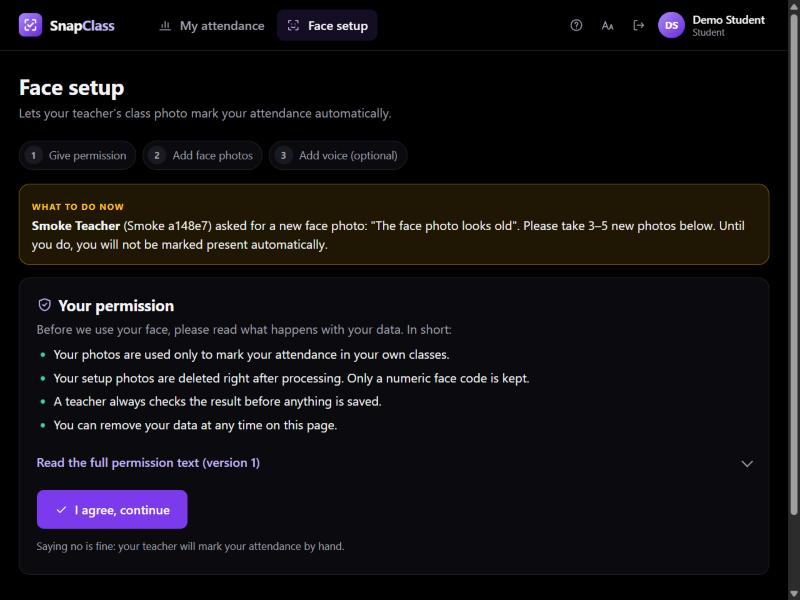
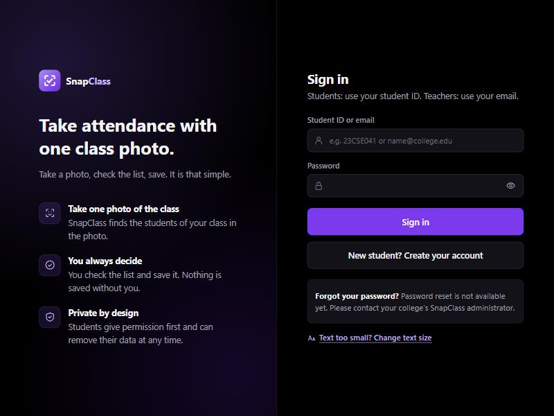
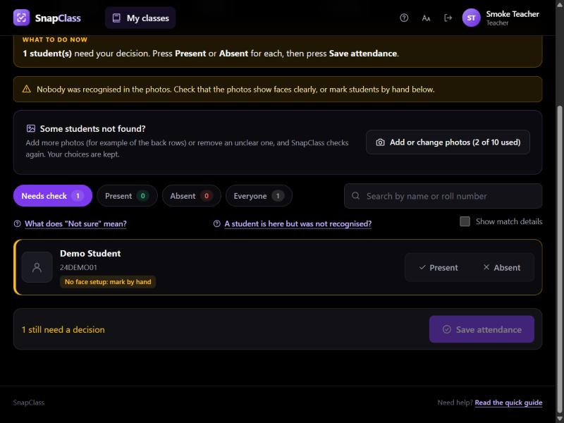
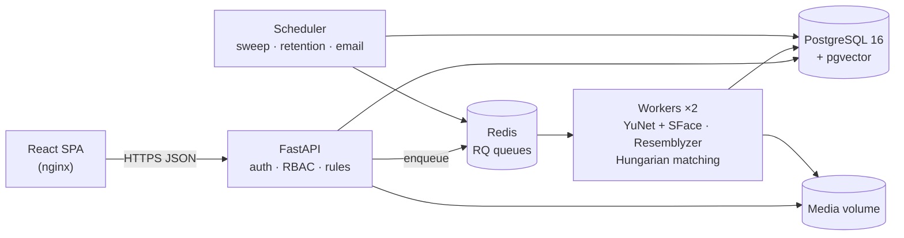

<p align="center">
  
</p>

<h1 align="center">SnapClass</h1>

<p align="center">
  <b>Classroom attendance from a photo — proposed by AI, confirmed by the teacher.</b><br/>
  FastAPI · PostgreSQL + pgvector · Redis/RQ · OpenCV · Resemblyzer · React · Docker
</p>

---

## What it does

Calling 60–120 names takes minutes every lecture and lets a friend answer "present" for someone
who is absent. With SnapClass:

1. The **teacher** takes 1–10 photos of the classroom (optionally a short roll-call recording).
2. A **background worker** finds every face, compares it **only with the students of that class**,
   and proposes *Present / Not sure / Not found* for each student.
3. The teacher checks the "Not sure" cases, can add more photos and check again, and presses
   **Save attendance**. **Nothing becomes attendance without that confirmation.**

**Students** register with their student ID, join classes with a QR code, set up their face once
(with explicit consent), and see their attendance per subject. **Admins** manage teachers,
settings and an audit trail.

| Teacher review | Add photos during review |
|---|---|
|  |  |
| **Student: face photo requested by the teacher** | **Student: guided face setup with consent** |
|  |  |

<details>
<summary>More screenshots</summary>




</details>

---

## Architecture



The API never runs ML. Slow work goes to a Redis queue; workers write **proposals**; only the
teacher's Save writes **attendance**. Full design: [System Design](docs/SYSTEM_DESIGN.md) ·
[HLD](docs/HLD.md) · [LLD](docs/LLD.md).

---

## Engineering highlights

| Area | What I built | Why it matters |
|---|---|---|
| **Human-in-the-loop by design** | Separate `match_results` (AI proposal) and `attendance_records` (truth) tables; Save is blocked until every "Not sure" is decided | A wrong "present" can't slip through the UI or the API |
| **Matching** | Roster-restricted search + **Hungarian one-to-one assignment** per photo, best view across photos, an uncertainty band | Fewer false accepts; no two faces can claim the same student |
| **Async pipeline** | Redis + RQ jobs with fixed job ids, 3 retries with back-off, failure callback only after the last retry, stuck-job sweeper | Idempotent, recoverable processing |
| **Concurrency** | Worker uses **two short transactions** (`SELECT … FOR UPDATE`) around the slow ML step and re-checks the status | No locks held during inference; late or duplicate jobs do nothing |
| **State machine** | One module defines every allowed status change; illegal moves → 409; photos can change until saving and the teacher's choices survive a re-check | Predictable behaviour, easy to test |
| **Security** | bcrypt, 15-min JWT, rotating refresh tokens with **reuse detection**, IDOR-safe ownership checks (404), login rate limits, magic-byte upload checks, **HMAC-signed media URLs**, CSV-injection escaping | OWASP basics covered and tested |
| **Privacy** | Versioned consent, embeddings only (selfies deleted), one-click erasure that keeps attendance history, retention job, audit log | Biometric data handled as sensitive data (DPDP Act, 2023) |
| **Usability** | Plain-language UI for non-technical teachers, "What to do now" guidance, search/filters for large classes, text size and high-contrast settings, 44 px targets | Designed with HCI principles ([notes](docs/design/ux-hci.md)) |
| **Quality** | 72 automated tests on real Postgres/Redis (unit, property-based, API, worker), 25-check end-to-end smoke test, ruff + mypy, Alembic migrations with drift check, CI | Changes are verified, not hoped |

---

## Tech stack

| Layer | Technology |
|---|---|
| Backend | Python 3.11, FastAPI, Pydantic v2, SQLModel (SQLAlchemy 2), Alembic |
| Data | PostgreSQL 16 + pgvector (HNSW), Redis 7 |
| Jobs | RQ (SimpleWorker, retries, scheduler) |
| ML | OpenCV YuNet (face detection) + SFace (128-d embeddings), webrtcvad + Resemblyzer (256-d voice), SciPy Hungarian, NumPy, ffmpeg |
| Frontend | React 19 + Vite, plain JavaScript and CSS (hand-drawn SVG icons, no UI library) |
| Ops | Docker Compose (7 services), nginx, GitHub Actions CI, JSON logs, Prometheus metrics |
| Testing | pytest, Hypothesis, httpx TestClient, Locust (load script) |

---

## Run it locally

Requirements: **Docker Desktop**.

```bash
cp .env.example .env        # set JWT_SECRET and ADMIN_PASSWORD
docker compose up --build   # first build downloads CPU PyTorch + OpenCV models (several minutes)
```

- App: <http://localhost:3000> — sign in with `ADMIN_EMAIL` / `ADMIN_PASSWORD` from `.env`
- API docs (OpenAPI): <http://localhost:8000/docs>

### Try the whole flow

1. **Admin** → add a teacher (teachers sign in with email).
2. **Teacher** → add a class → *Students* → *Create invite link* (QR code).
3. **Student** (invite link in a private window) → *No, I am new* → student ID, name, password →
   joined → consent → 3–5 face photos (voice optional). Students sign in with their **student ID**.
4. **Teacher** → *Take attendance* → take or choose up to 10 photos → *Check attendance* → review →
   *Save attendance*. Missing students? *Add or change photos* → *Check again* (your choices are kept).
5. **Not recognised?** *Ask for new face photo* → the student sees a pop-up; until they upload, they are
   not marked present automatically.
6. **Reports** → attendance %, below-minimum filter, download for Excel (CSV).

### Frontend with hot reload
```bash
cd frontend && npm install && npm run dev   # http://localhost:5173 (proxies /api to :8000)
```

---

## Tests and checks

```bash
docker compose run --rm api pytest                   # 72 tests (real Postgres + Redis)
docker compose run --rm api ruff check .             # lint
docker compose run --rm api mypy                     # types (domain + services)
docker compose run --rm api python smoke/smoke_e2e.py  # 25 end-to-end checks on the running stack
```

| Level | Covers |
|---|---|
| Unit | decision policy and fusion, every state transition, Hungarian vs greedy, property test (no double assignment), voice windowing |
| API | auth + refresh rotation + reuse detection, rate limit, RBAC (403), **IDOR (404)**, registration by student ID, join rules, consent gate, magic-byte rejection, full lecture flow, save blocked until decided, audited corrections, CSV, erasure keeps attendance, face photo requests, 10-photo limit, change photos during review |
| Worker | real Postgres + fake encoder: results, idempotent re-run, failure only after last retry, retention, open request blocks auto-present, re-check keeps teacher choices |
| End-to-end | nginx → API → Redis → worker (real models) → Postgres, with synthetic photos and audio |

---

## Project status (honest)

| Item | Status |
|---|---|
| Features above | Built and tested |
| 72 automated tests · 25/25 smoke checks | **Passing** |
| Face recognition accuracy (FAR/FRR) | **Not measured yet** — needs a consented dataset; evaluation script ready in [`backend/eval/`](backend/eval/README.md) |
| API latency / burst load | Not measured — Locust script in `backend/load/` |
| Usability study (SUS, task time) | Planned — see [ux-hci.md](docs/design/ux-hci.md) |
| Matching thresholds | Placeholder defaults until tuned on validation data |

**Out of scope / known limitations:** no liveness (printed-photo) detection; student-ID squatting is
possible without an official roster; tokens are stored in `localStorage`; no password reset yet;
webrtcvad can accept non-speech sound in the voice quality check. Each is discussed with a next step
in [System Design §12](docs/SYSTEM_DESIGN.md#12-security-and-privacy) and
[Interview Prep §8](docs/INTERVIEW_PREP.md#8-weaknesses-and-what-i-would-improve).

---

## Documentation

| Document | Read it for |
|---|---|
| [docs/SYSTEM_DESIGN.md](docs/SYSTEM_DESIGN.md) | Requirements, capacity estimates, architecture, trade-offs, scaling, failure modes, security |
| [docs/HLD.md](docs/HLD.md) | Components, deployment, sequence diagrams, state machine, async design, technology choices |
| [docs/LLD.md](docs/LLD.md) | Code layers, ER diagram, all 44 API routes, algorithms with math, jobs, security mechanisms, frontend |
| [docs/INTERVIEW_PREP.md](docs/INTERVIEW_PREP.md) | Study plan, concept primers, pitches, resume bullets, question bank, STAR stories |
| [docs/design/](docs/design/) | Decision records: build deviations, student accounts + face requests, HCI notes, rejected ERP design |
| [backend/eval/README.md](backend/eval/README.md) | How to measure accuracy correctly |

---

## Project layout

```
backend/
  snapclass/
    api/routers/   HTTP endpoints (thin)          services/   use-cases + SQL
    domain/        state machine, decision policy  ml/         face, voice, matcher
    workers/       RQ jobs, scheduler, maintenance core/       config, security, storage, errors
  migrations/      Alembic                         tests/      unit · api · worker
  eval/            FAR/FRR evaluation              smoke/      end-to-end smoke test
  load/            Locust load test
frontend/src/      React pages (teacher, student, admin), components, api client
docs/              system design, HLD, LLD, interview prep, decision records
docker-compose.yml db · redis · migrate · api · worker ×2 · scheduler · frontend
```

---

<sub>Built by Piyush Naula (B.Tech CSE, AI & ML). Biometric data is sensitive personal data: review the
consent text against India's DPDP Act, 2023 and your institution's policy before any real use.</sub>
