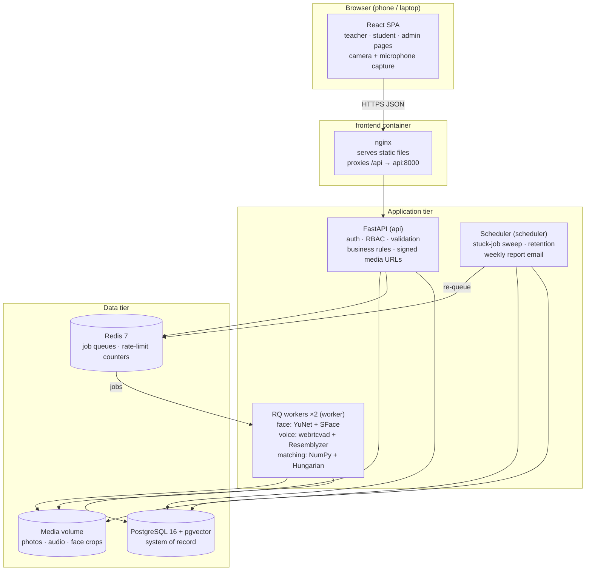
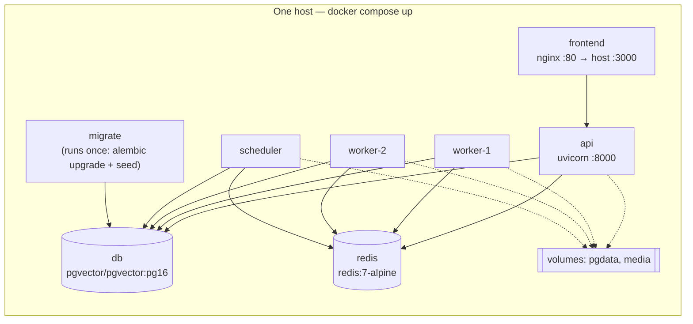
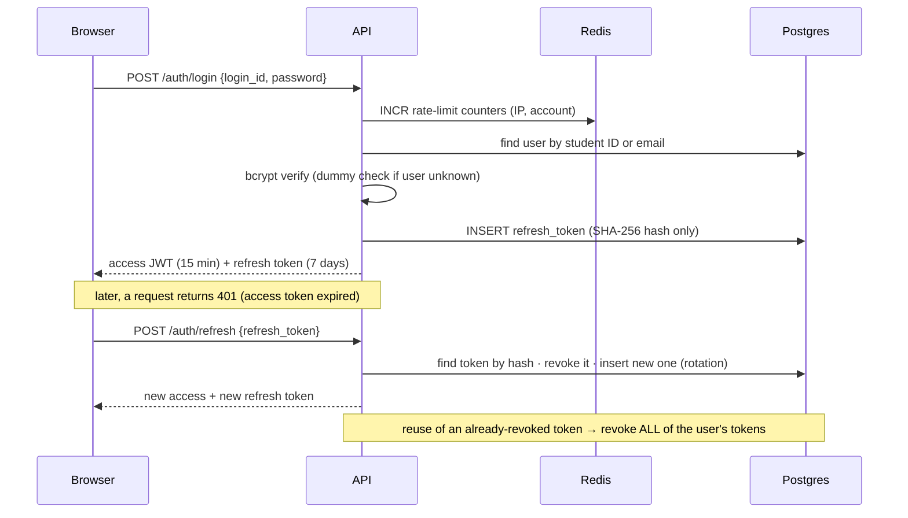
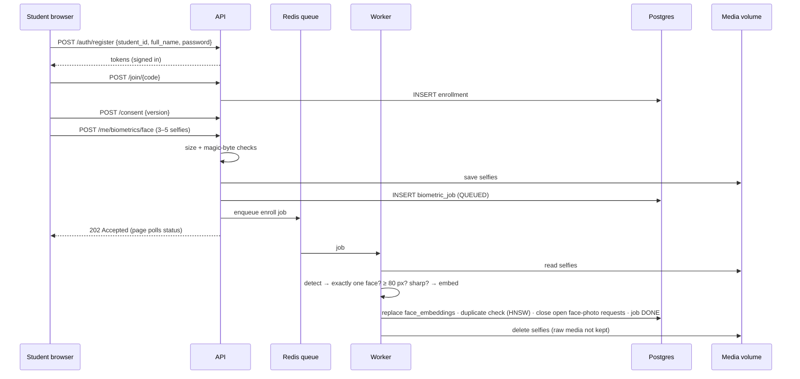
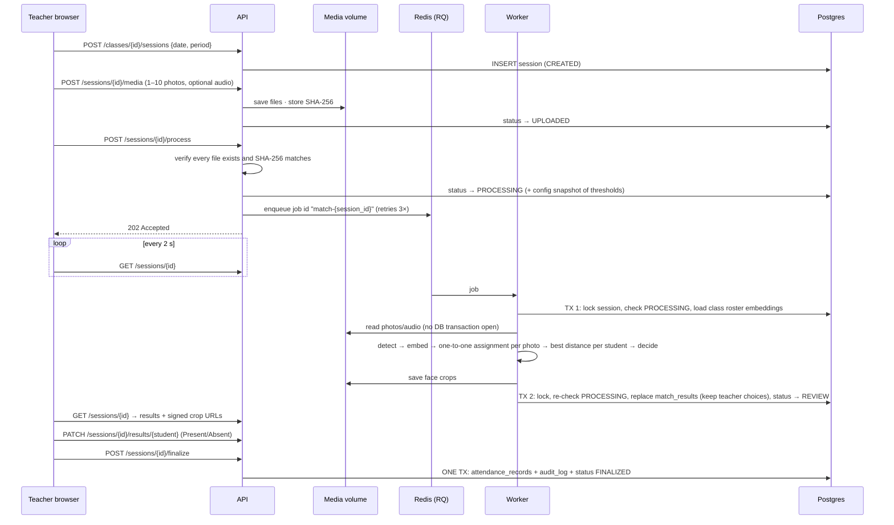
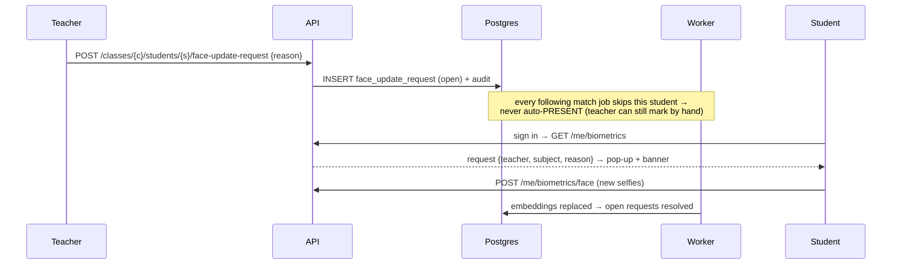
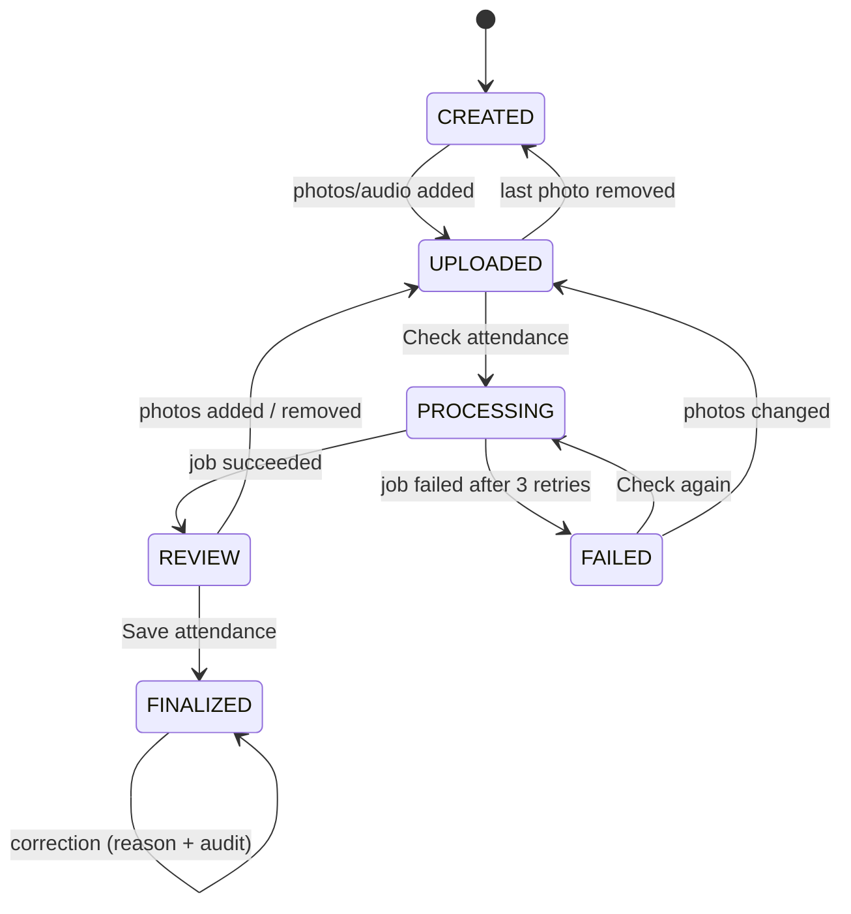

# SnapClass — High-Level Design (HLD)

> Scope: the **big boxes** — which components exist, what each one owns, how they talk, and how
> the main user journeys flow through them. For tables, APIs and algorithms see [LLD.md](LLD.md).
> For requirements, estimates and trade-offs see [SYSTEM_DESIGN.md](SYSTEM_DESIGN.md).

---

## 1. Architecture at a glance

**One sentence:** the browser talks only to the API; the API stores data, saves files and puts slow
work on a Redis queue; workers do the ML and write results back; a scheduler does housekeeping.

---

## 2. Components and responsibilities

| Component | Owns | Does **not** do | Scales by |
|---|---|---|---|
| **React SPA** | Screens for 3 roles, camera/mic capture, image compression (≤ 2048 px), polling, accessibility settings | Business rules (server is the source of truth) | Static files (CDN-able) |
| **nginx** | Static hosting, `/api` reverse proxy, 50 MB body limit, security headers | Logic | Replicas |
| **FastAPI API** | Authentication, RBAC, input validation, ownership checks (IDOR), state machine, file storage, queueing, reports, signed URLs | Any ML (keeps it fast and light) | Stateless → horizontal replicas |
| **RQ workers** | Match jobs (class photos/audio → proposals), enrollment jobs (selfies/voice → embeddings + quality checks) | HTTP | Number of worker processes (queue depth) |
| **Scheduler** | Re-queue stuck lectures (> 10 min), retention cleanup (hourly), weekly below-minimum email (Monday 08:00 IST) | Request handling | Exactly one instance |
| **PostgreSQL + pgvector** | Users, classes, lectures, proposals, attendance (truth), embeddings, consents, audit log, settings | Files | Vertical; read replica later |
| **Redis** | Job queues `match` (high priority) and `enroll`, retry scheduling, login rate-limit counters | Durable data | Single node at this scale |
| **Media volume** | Class photos, roll-call audio, face crops, temporary enrollment selfies | Metadata | Swap for S3 (same interface) |

---

## 3. Deployment view (Docker Compose)

- One backend **image** is used for `api`, `worker`, `scheduler` and `migrate` (different start commands).
- Start order is enforced: `db` healthy → `migrate` completes → `api`/`worker`/`scheduler` start.
- Health checks: Postgres `pg_isready`, Redis `PING`, API `/healthz`.
- Secrets (`JWT_SECRET`, admin password) come from `.env` (git-ignored); `.env.example` documents them.
- Cloud path (not deployed): EC2 + RDS (pgvector supported) + S3, HTTPS via load balancer/ACM or Caddy.

---

## 4. Main flows

### 4.1 Sign in and token refresh

### 4.2 Student onboarding (register → join → consent → face enrollment)

### 4.3 Taking attendance (the core flow)

**Add photos during review:** `POST /sessions/{id}/media` (or `DELETE .../media/{mid}`) moves the lecture
from REVIEW back to UPLOADED; "Check again" runs the same job, which **keeps the teacher's own
Present/Absent choices** (unless the teacher ticks "start fresh").

### 4.4 Face photo request (re-capture)

---

## 5. Lecture (session) state machine

- All transitions are checked in **one place** (`domain/session.py`); an illegal move → HTTP 409.
- Photos are **locked** only while PROCESSING (the worker is reading them) and after FINALIZED.

---

## 6. Asynchronous processing design

| Concern | Design |
|---|---|
| Queues | `match` (teacher is waiting → processed first) and `enroll` |
| Job identity | `match-{session_id}` — one job per lecture; duplicates impossible |
| Retries | `Retry(max=3, interval=[10, 30, 60])`; needs the RQ scheduler (`with_scheduler=True`) |
| Failure | `on_failure` callback runs after **every** failed attempt (verified in RQ source), so it marks FAILED only when `retries_left` is 0 |
| Idempotency | Worker re-checks `status == PROCESSING` under a row lock before writing; late/duplicate jobs do nothing |
| Locks | Two short transactions; no lock is held during file I/O or inference |
| Stuck jobs | Scheduler re-queues lectures in PROCESSING > 10 min if no live job exists |
| Model loading | Models load **once per worker** at start-up (RQ `SimpleWorker`, no fork per job) and the voice model is **warmed up** (first call compiles librosa code: 18 s cold → 0.4 s warm, measured once) |
| Back-pressure | Queue depth visible on the admin dashboard; add workers when it grows |

---

## 7. Technology choices

| Layer | Choice | Why | Alternatives considered |
|---|---|---|---|
| API | Python 3.11, FastAPI, Pydantic v2 | Typed, fast to build, automatic OpenAPI docs, same language as the ML | Django REST (heavier), Node/Express (ML in another language) |
| ORM / migrations | SQLModel (SQLAlchemy 2) + Alembic | Typed models; explicit transactions; versioned schema | Raw SQL only |
| Database | PostgreSQL 16 + pgvector | One store for relational data **and** vectors, with transactions | Separate vector DB (unnecessary at ~30 MB of vectors) |
| Queue | Redis 7 + RQ | Simple, Redis-only | Celery (more config), Kafka (overkill) |
| Face | OpenCV YuNet (detector) + SFace (128-d) | pip install, CPU-friendly, finds small faces | dlib (needs C++ build; HOG misses back rows), InsightFace/ArcFace (stronger, heavier) |
| Voice | webrtcvad + Resemblyzer (256-d) + ffmpeg | Lightweight speaker embeddings; ffmpeg decodes browser audio | SpeechBrain ECAPA (stronger, heavier) |
| Assignment | SciPy `linear_sum_assignment` | Optimal one-to-one matching | Greedy (simpler, can be wrong) |
| Frontend | React 19 + Vite, plain JavaScript and CSS | Simple to read; author's requirement: no extra frontend stack | Next.js (SSR not needed), Tailwind/TypeScript (more tooling) |
| Auth | PyJWT + bcrypt | Standard, explicit | Managed auth service |
| Ops | Docker Compose, GitHub Actions CI, JSON logs, Prometheus metrics | Reproducible local stack, automated checks | Kubernetes (overkill) |

---

## 8. Cross-cutting concerns

- **Security:** see [SYSTEM_DESIGN.md §12](SYSTEM_DESIGN.md#12-security-and-privacy).
- **Errors:** every error has the same JSON shape with a `request_id`; no stack traces leave the server.
- **Configuration:** `pydantic-settings` reads environment variables; runtime-changeable settings
  (thresholds, retention) live in the `app_settings` table and every change is audited.
- **Reproducibility of decisions:** each lecture stores the thresholds and model versions it used
  (`config_snapshot`), so any decision can be explained later.
- **Usability:** the UI follows Nielsen's heuristics and accessibility rules (text size, high contrast,
  44 px targets, keyboard, screen reader labels) — see [design/ux-hci.md](design/ux-hci.md).
