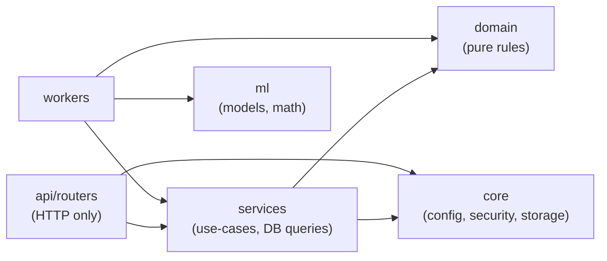
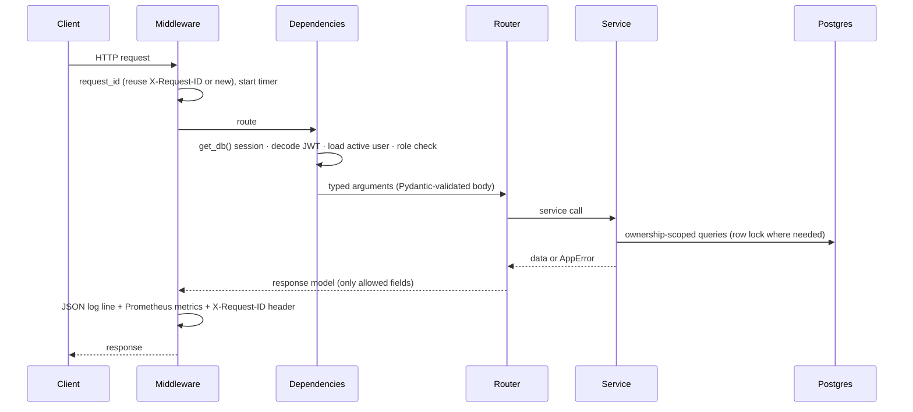
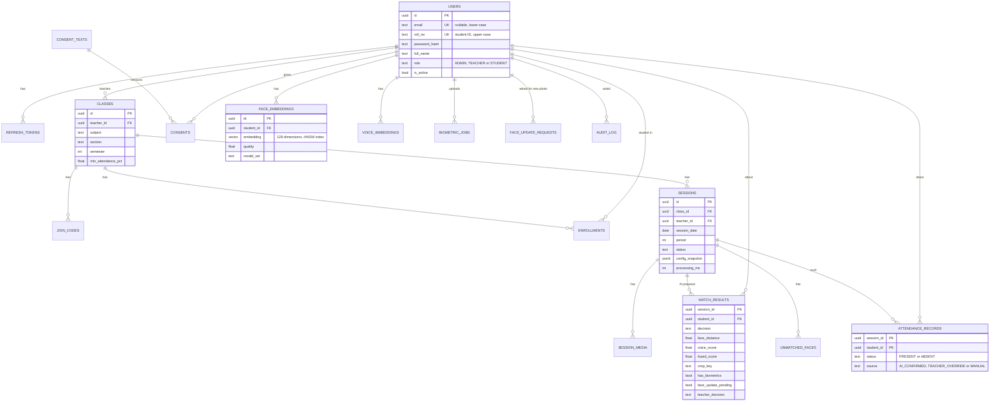

# SnapClass — Low-Level Design (LLD)

> Scope: **inside the boxes** — code structure, database tables, every API endpoint, the algorithms
> (with the real math), and how the frontend is built. Read [HLD.md](HLD.md) first for the big picture.

## Contents
1. [Code structure and layering](#1-code-structure-and-layering)
2. [Backend modules](#2-backend-modules)
3. [Request lifecycle](#3-request-lifecycle)
4. [Data model](#4-data-model)
5. [API contract](#5-api-contract)
6. [Algorithms](#6-algorithms)
7. [Background jobs](#7-background-jobs)
8. [Security mechanisms](#8-security-mechanisms)
9. [Frontend design](#9-frontend-design)
10. [Configuration reference](#10-configuration-reference)
11. [Testing strategy](#11-testing-strategy)

---

## 1. Code structure and layering

```
backend/
├── snapclass/
│   ├── main.py              app factory: routers, middleware (request id, logs, metrics), error handlers
│   ├── models.py            18 SQLModel tables (the database schema)
│   ├── schemas.py           Pydantic request/response models (what leaves the server)
│   ├── api/
│   │   ├── deps.py          DB session, current user, role checks (RBAC)
│   │   └── routers/         auth, admin, classes, join, students, sessions, media, health  (thin)
│   ├── services/            use-cases: auth, class, biometric, session, face_update, report, admin, settings, audit
│   ├── domain/              pure rules, no I/O: session state machine, decision policy
│   ├── ml/                  face (YuNet+SFace), voice (VAD+Resemblyzer), matcher (Hungarian)
│   ├── workers/             RQ jobs (match, enroll), queue helpers, failure callbacks, scheduler, maintenance
│   ├── core/                config, db, security, storage, uploads, rate limit, logging, errors, redis
│   └── scripts/seed.py      first admin + consent text
├── migrations/              Alembic (2 revisions)
├── tests/                   unit/ · api/ · worker/   (56 test functions → 72 test cases)
├── eval/evaluate.py         FAR/FRR/EER evaluation with a person-level split
└── load/locustfile.py       load test
frontend/src/
├── App.jsx · router.jsx · api.js · hooks.js
├── components/              Layout, Logo, Icons, ui (shared pieces), CameraCapture, AudioRecorder,
│                            Toast, HelpDialog, DisplaySettings, FaceRequestDialog
├── pages/                   LoginPage, RegisterPage, JoinPage, teacher/*, student/*, admin/*
└── styles.css · usability.css
```

### Layering rule



- **Routers** parse HTTP, check the role, call **one** service function, shape the response.
- **Services** hold the use-case logic and the SQL. Every teacher query goes through an ownership
  helper (`get_owned_class`, `get_owned_session`) → IDOR protection lives in one place.
- **Domain** has no imports of FastAPI or the database → unit-testable in milliseconds.
- **ML** is imported only by workers → the API container starts fast and never loads models.
- Simplification vs a textbook design: there is **no repository layer**; services query SQLModel
  directly (fewer files to read; services are tested against a real Postgres instead).

---

## 2. Backend modules

| Module | Key functions | Notes |
|---|---|---|
| `domain/session.py` | `check_transition`, `can_change_media`, `status_after_media_change` | Single source of truth for the state machine |
| `domain/decisions.py` | `Thresholds`, `decide`, `face_distance_to_similarity`, `Thresholds.problems()` | Decision policy + threshold validation |
| `ml/face.py` | `OpenCVFaceEncoder.encode`, `decode_image`, `sharpness`, `crop_face` | Behind a `FaceEncoder` protocol → model swap is one file |
| `ml/matcher.py` | `RosterMatcher.distance_matrix/assign`, `one_to_one_assign` | Vectorised NumPy + SciPy Hungarian |
| `ml/voice.py` | `decode_audio` (ffmpeg), `speech_runs` (webrtcvad), `make_windows`, `VoiceEmbedder` | Warm-up call at start-up |
| `services/auth_service.py` | `login`, `register_student`, `rotate_refresh_token`, `logout`, `find_user` | Student ID vs email by the presence of `@` |
| `services/class_service.py` | `get_owned_class`, `create_join_code` (QR), `join_class`, `roster`, `remove_student` | |
| `services/session_service.py` | `add_media`, `remove_media`, `start_processing`, `session_detail`, `set_teacher_decision`, `finalize`, `correct_attendance` | The core use-cases |
| `services/biometric_service.py` | consent, `start_enrollment`, `erase_biometrics`, `status` | |
| `services/face_update_service.py` | `request_new_photo`, `cancel_requests`, `resolve_for_student`, `open_request_ids` | Re-capture feature |
| `services/report_service.py` | `class_report` (SQL), `report_to_csv`, `my_attendance` | CSV-injection safe |
| `workers/match_job.py` | `run_match`, `match_faces`, `match_voice`, roster loaders | Two-transaction job |
| `workers/enroll_job.py` | `enroll_face`, `enroll_voice`, `find_duplicate_face` | Quality checks |
| `workers/queue.py` | `enqueue_match`, `enqueue_enrollment`, `is_job_active`, `queue_depths` | Jobs referenced by import path string |
| `workers/callbacks.py` | `match_failed`, `enrollment_failed` | Only the last retry marks FAILED |
| `workers/maintenance.py` | `sweep_stuck_sessions`, `apply_retention`, `send_weekly_reports` | Called by the scheduler loop |

---

## 3. Request lifecycle



**Error format** (one handler for each error kind in `core/errors.py`):

```json
{"error": {"code": "REVIEW_INCOMPLETE", "message": "Please decide for 2 student(s) ...", "request_id": "3f1c..."}}
```

| HTTP | Typical codes |
|---|---|
| 400 | `BAD_REQUEST`, `INVALID_FILE_TYPE`, `EMPTY_FILE` |
| 401 | `UNAUTHORIZED`, `INVALID_CREDENTIALS`, `INVALID_REFRESH_TOKEN` |
| 403 | `FORBIDDEN`, `CONSENT_REQUIRED` |
| 404 | `NOT_FOUND` (also used for other people's data, so ids cannot be probed) |
| 409 | `CONFLICT`, `INVALID_TRANSITION`, `REVIEW_INCOMPLETE`, `MEDIA_LOCKED`, `STUDENT_ID_TAKEN`, `MEDIA_MISSING` |
| 413 | `FILE_TOO_LARGE` |
| 422 | `VALIDATION_ERROR` |
| 429 | `RATE_LIMITED` |
| 503 | `QUEUE_UNAVAILABLE` |

---

## 4. Data model

### 4.1 ER diagram



### 4.2 Tables

| Table | Purpose | Key columns and constraints |
|---|---|---|
| `users` | Everyone | `email` UNIQUE nullable (students may have none) · `roll_no` UNIQUE (student ID) · CHECK role |
| `refresh_tokens` | Rotating refresh tokens | `token_hash` UNIQUE (SHA-256 only) · `revoked_at` · `replaced_by` → self (rotation chain) |
| `classes` | A subject taught by a teacher | UNIQUE (subject, section, semester) · `min_attendance_pct` default 75 |
| `join_codes` | Invite codes | 8-char URL-safe code PK · `expires_at` · `max_uses` / `uses` |
| `enrollments` | Class roster | PK (class_id, student_id) · CASCADE |
| `consent_texts` / `consents` | Versioned consent | PK (student_id, version) · `withdrawn_at` |
| `face_embeddings` | Face samples | `vector(128)` · **HNSW index (vector_l2_ops)** · `model_ver` · CASCADE on user delete |
| `voice_embeddings` | Voice samples | `vector(256)` · CASCADE |
| `biometric_jobs` | Enrollment job status shown to the student | CHECK kind/status · `message` with per-photo reasons |
| `face_update_requests` | "Please upload a new face photo" | `resolved_at` NULL = open · `session_id` SET NULL on delete |
| `sessions` | One lecture | UNIQUE (class_id, session_date, period) · CHECK status · `config_snapshot` JSONB · index on status |
| `session_media` | Uploaded photos/audio | `sha256` · `size_bytes` · `deleted_at` (retention) |
| `match_results` | **AI proposal** | PK (session, student) · CHECK decision · `teacher_decision` (PRESENT/ABSENT/NULL) |
| `unmatched_faces` | Faces matching nobody | crop for the teacher |
| `attendance_records` | **The truth** | PK (session, student) · CHECK status/source · index on student_id |
| `audit_log` | Sensitive actions | BIGSERIAL · `before`/`after` JSONB · `reason` · index on action |
| `app_settings` | Runtime settings | key → JSONB value (thresholds, retention, enrollment) |

### 4.3 Modelling decisions to remember
- **Proposal ≠ truth:** only `finalize()` writes `attendance_records`.
- **Erasure by cascade:** deleting embeddings never touches attendance history.
- **Explainability:** `sessions.config_snapshot` stores thresholds + model versions per lecture.
- **Database-level safety nets:** CHECK constraints on every status column; UNIQUE constraints stop
  duplicate lectures and duplicate student IDs even under race conditions.
- **Migrations:** `052fba7395ad` (initial schema + `CREATE EXTENSION vector`), `74b2ec1edf3a`
  (student-ID login, face requests; new NOT NULL column added with `server_default false`).

### 4.4 Report query (attendance % per student)

```sql
SELECT u.id AS student_id, u.roll_no, u.full_name,
       COUNT(a.student_id) FILTER (WHERE a.status = 'PRESENT') AS present,
       COUNT(a.student_id) AS total
FROM enrollments e
JOIN users u ON u.id = e.student_id
LEFT JOIN (
    attendance_records a
    JOIN sessions s ON s.id = a.session_id
                   AND s.class_id = :class_id
                   AND (CAST(:from_date AS DATE) IS NULL OR s.session_date >= :from_date)
                   AND (CAST(:to_date   AS DATE) IS NULL OR s.session_date <= :to_date)
) ON a.student_id = u.id
WHERE e.class_id = :class_id
GROUP BY u.id, u.roll_no, u.full_name;
```
The `LEFT JOIN` keeps students with zero lectures; parameters are bound (no SQL injection).

---

## 5. API contract

Base path `/api/v1`. Auth = `Authorization: Bearer <access token>`.

### Auth
| Method | Path | Who | Body → Response |
|---|---|---|---|
| POST | `/auth/register` | public | `{student_id, full_name, password}` → 201 tokens + user · 409 `STUDENT_ID_TAKEN` · rate limit 5/hour/IP |
| POST | `/auth/login` | public | `{login_id, password}` (student ID, or email if it contains `@`) → tokens + user · 401 · 429 |
| POST | `/auth/refresh` | public | `{refresh_token}` → new tokens (rotation) |
| POST | `/auth/logout` | any | `{refresh_token}` → 204 |
| GET | `/auth/me` | any | → user |

### Classes and roster (teacher; foreign class → 404)
| Method | Path | Body → Response |
|---|---|---|
| POST | `/classes` | `{subject, section, semester, min_attendance_pct}` → 201 class · 409 duplicate |
| GET | `/classes` | → own classes with `student_count` |
| GET | `/classes/{id}` | → class |
| POST | `/classes/{id}/join-codes` | `{hours?, max_uses?}` → `{code, join_url, qr_png_base64, expires_at}` |
| GET | `/classes/{id}/students` | → roster with `face_samples`, `voice_samples`, `face_update_requested` |
| DELETE | `/classes/{id}/students/{sid}` | → 204 (audited) |
| POST | `/classes/{id}/students/{sid}/face-update-request` | `{reason, session_id?}` → 201 (idempotent) |
| DELETE | `/classes/{id}/students/{sid}/face-update-request` | → 204 |
| GET | `/classes/{id}/sessions` | → lectures (newest first) |
| POST | `/classes/{id}/sessions` | `{session_date, period}` → 201 · 409 if the same date+period exists |
| GET | `/classes/{id}/report?from&to&below&format=csv` | → rows `{present, total, pct, below_threshold}` or CSV |

### Join (student)
| Method | Path | Body → Response |
|---|---|---|
| GET | `/join/{code}` | public → `{subject, section, semester}` · 404 expired · 410 used up |
| POST | `/join/{code}` | signed-in **student** → `{class_id, subject, already_joined}` |

### Lectures (teacher; foreign lecture → 404)
| Method | Path | Body → Response |
|---|---|---|
| GET | `/sessions/{id}` | → `SessionDetail` (status, summary counts, results with signed crop URLs, media list, unmatched faces) |
| POST | `/sessions/{id}/media` | multipart `photos[]` (≤ 10 total, ≤ 8 MB each), `audio` (≤ 1, ≤ 10 MB) → detail · 409 `MEDIA_LOCKED` while processing/after save |
| DELETE | `/sessions/{id}/media/{mid}` | → detail (status → UPLOADED or CREATED) |
| POST | `/sessions/{id}/process?clear_decisions=false` | → **202** queued now · **200** already queued/done (idempotent) · 503 queue down |
| PATCH | `/sessions/{id}/results/{sid}` | `{teacher_decision: PRESENT|ABSENT|null}` → 204 (REVIEW only) |
| POST | `/sessions/{id}/finalize` | → detail · 409 `REVIEW_INCOMPLETE` |
| PATCH | `/sessions/{id}/attendance/{sid}` | `{status, reason (≥ 3 chars)}` → 204 (FINALIZED only, audited) |

### Student self-service
| Method | Path | Body → Response |
|---|---|---|
| GET | `/consent/current` | → `{version, body, accepted}` |
| POST | `/consent` | `{version}` → 204 (must be the current version) |
| GET | `/me/biometrics` | → consent state, sample counts, recent jobs, `face_update_request` |
| POST | `/me/biometrics/face` | 3–5 images → 202 job · 403 `CONSENT_REQUIRED` |
| POST | `/me/biometrics/voice` | exactly 3 clips → 202 job |
| DELETE | `/me/biometrics` | → 204 (embeddings deleted, consent withdrawn, attendance kept) |
| GET | `/me/attendance` | → per class: present, total, pct, full history |

### Admin
`GET /admin/metrics` · `GET/POST /admin/teachers` · `PATCH /admin/users/{id}` (on/off, revokes tokens) ·
`GET/PUT /admin/settings` (validated thresholds, retention 1–90 days) · `GET /admin/audit?limit=`

### Media and ops
`GET /media/{key}?exp=&sig=` (HMAC-signed, 5 min, only `crops/` and class photos) ·
`GET /healthz` (alive) · `GET /readyz` (DB + Redis) · `GET /metrics` (Prometheus)

---

## 6. Algorithms

### 6.1 Face pipeline (`ml/face.py`)

1. **Decode** bytes with OpenCV; scale so the long side ≤ 2048 px (speed).
2. **Detect** with YuNet (CNN). Each detection = box + 5 landmarks + confidence (threshold 0.7).
3. Drop faces smaller than `min_face_px` (24 px in class photos, 80 px for enrollment).
4. **Align** the face to 112×112 using the landmarks (`alignCrop`), then **embed** with SFace → 128 numbers.
5. **Normalise** to unit length: `e = e / ‖e‖`.
6. **Quality** = detector confidence × min(1, sharpness / (2 × blur_threshold)), where
   sharpness = variance of the Laplacian (edge strength; blurry images have weak edges).
7. Boxes are scaled back to original pixels so face crops line up.

### 6.2 Distance and similarity

For unit vectors `a` and `b`:

```
L2 distance  d = ‖a − b‖              (0 = identical … 2 = opposite)
cosine       c = a · b
relation     d² = 2 − 2c   →   c = 1 − d² / 2
```
Faces are compared with L2 (works with the pgvector `<->` operator and HNSW `vector_l2_ops`);
fusion converts face distance to cosine so face and voice are on the same scale.

### 6.3 Roster matching with one-to-one assignment (`ml/matcher.py`)

```python
# distance matrix: rows = faces in one photo, columns = students in the class
# each cell = smallest distance from that face to any of the student's enrolled samples
D[:, j] = np.linalg.norm(probes[:, None, :] - gallery_j[None, :, :], axis=2).min(axis=1)

def one_to_one_assign(D, reject_above):
    cost = np.where(D > reject_above, 1e6, D)        # forbid impossible pairs
    rows, cols = linear_sum_assignment(cost)          # Hungarian algorithm
    return [(r, c, D[r, c]) for r, c in zip(rows, cols) if D[r, c] <= reject_above]
```

- **Why not nearest neighbour?** Two faces could both pick the same student. Hungarian minimises the
  *total* distance under the rule "each face ↔ at most one student and vice versa".
- **Across photos:** each photo is assigned on its own; a student's final distance is the
  **minimum** over all photos (one clear view is enough). The best crop is kept for review.
- Faces assigned to nobody become `unmatched_faces` (with their best distance).
- **Property tested** (Hypothesis): for random inputs, no student or face is used twice and every
  returned distance ≤ the reject threshold.

### 6.4 Decision policy and fusion (`domain/decisions.py`)

Default thresholds (placeholders until tuned on validation data):

| Name | Value | Meaning |
|---|---|---|
| `face_accept` | 1.05 (≈ cosine 0.45) | face distance ≤ this → PRESENT |
| `face_reject` | 1.15 (≈ cosine 0.34) | above this → NOT_DETECTED; between → UNCERTAIN |
| `voice_accept` / `voice_reject` | 0.80 / 0.65 | cosine similarity |
| `fused_accept` / `fused_reject` | 0.55 / 0.43 | = 0.7 × face + 0.3 × voice thresholds |
| `w_face` | 0.7 | face weight in fusion |

```python
def decide(face_d, voice_s, t):
    if face_d is None and voice_s is None:  return NOT_DETECTED
    if voice_s is None:                      # face only
        return PRESENT if face_d <= t.face_accept else UNCERTAIN if face_d <= t.face_reject else NOT_DETECTED
    if face_d is None:                       # voice only → never PRESENT
        return UNCERTAIN if voice_s >= t.voice_reject else NOT_DETECTED
    fused = t.w_face * (1 - face_d**2 / 2) + (1 - t.w_face) * voice_s
    return PRESENT if fused >= t.fused_accept else UNCERTAIN if fused >= t.fused_reject else NOT_DETECTED
```

Overrides applied by the match job before `decide`: a student with **no samples** or an **open
face-photo request** → NOT_DETECTED (no automatic PRESENT).

### 6.5 From proposal to truth (`session_service.finalize`)

```
needs teacher decision  =  decision == UNCERTAIN  or  student has no biometrics
finalize refused (409)  if any such student has no teacher_decision

final status / source:
  no biometrics                      → teacher's choice,  MANUAL
  no teacher choice                  → PRESENT if AI said PRESENT else ABSENT,  AI_CONFIRMED
  AI UNCERTAIN or teacher disagreed  → teacher's choice,  TEACHER_OVERRIDE
  teacher agreed with AI             → teacher's choice,  AI_CONFIRMED
```
Attendance rows + `SESSION_FINALIZE` audit entry + status change commit in **one transaction**.

### 6.6 Voice pipeline (`ml/voice.py`)

1. `ffmpeg` decodes any browser/phone format → 16 kHz mono, at most 60 s.
2. `webrtcvad` (aggressiveness 2) labels each 30 ms frame speech/silence.
3. **Speech runs**: consecutive speech frames, joining gaps < 300 ms.
4. **Windows**: drop runs < 1 s; split runs > 3 s into 3 s pieces. (Runs are *not* merged across
   silences, so two students' voices never end up in one window.)
5. Resemblyzer embeds each window → 256 numbers (unit length).
6. Cosine similarity to each student's mean voice embedding → same one-to-one assignment with
   `distance = 1 − similarity`.

### 6.7 Enrollment quality checks (`workers/enroll_job.py`)

| Check | Rule | Message to the student |
|---|---|---|
| Readable | decodes as an image | "File could not be read as an image" |
| Face count | exactly 1 | "No face found…" / "Make sure only your face is in the photo" |
| Size | shortest side ≥ 80 px | "Move closer to the camera" |
| Sharpness | Laplacian variance ≥ 40 (admin setting) | "Photo is blurry, hold steady" |
| Enough photos | ≥ 3 good photos | "Need at least 3 good photos, got N." |
| Duplicate account | nearest face of **another** student closer than 0.9 | audit flag for the admin (not blocking) |
| Voice | ≥ 3 s of detected speech per clip | "Please read the full sentence" |

Duplicate check (uses the HNSW index across all students):
```sql
SELECT student_id, embedding <-> CAST(:emb AS vector) AS distance
FROM face_embeddings WHERE student_id <> :student_id
ORDER BY embedding <-> CAST(:emb AS vector) LIMIT 1;
```

---

## 7. Background jobs

### 7.1 Match job (`workers/match_job.py::run_match`)

```
TX 1  lock session (SELECT … FOR UPDATE)
      if status != PROCESSING → stop            (duplicate or late job)
      load thresholds from config_snapshot
      load face roster   = {student: (k,128)} for THIS class, current model version
      load voice roster  = {student: mean(256)}
      remove students with an open face-photo request from both rosters
      list media keys
      (transaction ends → lock released)

—     read files, delete old crops, detect/embed/assign per photo, voice windows   (seconds, no lock)

TX 2  lock session again; if status != PROCESSING → stop
      remember existing teacher_decision values      (re-check must not lose them)
      delete old match_results + unmatched_faces
      insert one result per enrolled student (decide + overrides + kept teacher choice)
      status → REVIEW, processing_ms, model versions into config_snapshot
      commit
```

### 7.2 Queue settings (`workers/queue.py`)
| Job | Queue | Id | Timeout | Retry | On failure |
|---|---|---|---|---|---|
| match | `match` | `match-{session_id}` | 600 s | 3× (10/30/60 s) | `match_failed` → FAILED only when `retries_left` is 0 |
| enroll face/voice | `enroll` | `enroll-{job_id}` | 300 s | none | `enrollment_failed` → job FAILED + friendly message |

Workers: `SimpleWorker(["match", "enroll"], with_scheduler=True)`; models pre-loaded and warmed up.

### 7.3 Scheduler loop (`workers/scheduler.py`, every 60 s)
- `sweep_stuck_sessions` — PROCESSING > 10 min and no live job → re-queue.
- `apply_retention` (hourly) — finalized > N days → delete media files + crops, mark `deleted_at`.
- `send_weekly_reports` — Monday ≥ 08:00 IST, once per ISO week (Redis `SET NX` key).

---

## 8. Security mechanisms

| Mechanism | Where | How |
|---|---|---|
| Password hashing | `core/security.py` | bcrypt cost 12 (4 in tests only) |
| Access token | `create_access_token` | HS256 JWT `{sub, role, type: "access", iat, exp: +15 min}` |
| Refresh rotation | `auth_service.rotate_refresh_token` | find by SHA-256 hash → if revoked: revoke **all** user tokens (theft) → else issue new, mark old `revoked_at` + `replaced_by` (new row flushed first because of the FK) |
| Rate limiting | `core/rate_limit.py` | Redis `INCR` + `EXPIRE` fixed window; fails open if Redis is down (logged) |
| RBAC | `api/deps.py` | `require_role("TEACHER")` etc. as FastAPI dependencies |
| IDOR | `get_owned_class`, `get_owned_session` | `WHERE id = :id AND teacher_id = :me` → 404 |
| Upload checks | `core/uploads.py` | read at most limit+1 bytes; magic bytes (JPEG `FF D8 FF`, PNG `89 50 4E 47`, WEBM `1A 45 DF A3`, WAV `RIFF…WAVE`, OGG, MP3, MP4 `ftyp`) |
| Signed URLs | `signed_media_url` | `HMAC-SHA256(secret, key:expiry)`, 5 min; `hmac.compare_digest`; only crops and class photos |
| Safe storage keys | `core/storage.py` | regex allow-list + no `..` → no path traversal |
| Consent gate | `biometric_service` | current consent version required for uploads; re-checked inside the job |
| CSV injection | `report_service._safe_cell` | prefix `'` for cells starting with `= + - @` |

---

## 9. Frontend design

### 9.1 Structure
- **No router library:** `router.jsx` (~40 lines) reads `location.hash` (`#/sessions/123`), so the
  server never needs special routes. `matchRoute('/classes/:id', path)` → `{ id }`.
- **API client (`api.js`):** adds the bearer token; on 401 calls `/auth/refresh` **once** (parallel
  requests share one refresh promise) and retries; maps error codes to plain-language messages;
  network failure → "Cannot reach SnapClass…".
- **Data hooks (`hooks.js`):** `useLoad(loader, deps)` → `{data, error, loading, reload}`;
  `useInterval(fn, ms, active)` for polling while PROCESSING.
- **State:** server data lives in page components (reloaded after actions); only UI state is local.

### 9.2 Pages by role
| Role | Pages |
|---|---|
| Teacher | `ClassesPage` (getting-started guide) → `ClassPage` (Take attendance · Students · Reports) → `SessionPage` (Stepper → PhotoStep → ProcessingStep → ReviewStep → SavedStep) |
| Student | `RegisterPage`, `JoinPage`, `StudentHome` (progress ring, advice, history, face-request pop-up), `BiometricsPage` (consent → face → voice) |
| Admin | `AdminPage` (metrics, teachers, settings with "Advanced" thresholds, activity history) |

### 9.3 Notable components
- `CameraCapture` — `getUserMedia` live preview with face/class guide, shutter flash, switch camera;
  falls back to `<input capture>` (phone camera app) when the page is not a secure context.
- `AudioRecorder` — `MediaRecorder` with auto-stop and a progress bar.
- `compressImage` — browser-side resize to 2048 px JPEG before upload (saves bandwidth/storage).
- `Dialog` / `ConfirmDialog` — native `<dialog>` (focus trap and Escape for free).
- `Toast` — `aria-live` notifications for every important action.
- `DisplaySettings` — text size (16/18/20 px root) and high contrast, saved per device.

### 9.4 Usability (HCI)
Plain-language status labels with icons (not colour alone), "What to do now" boxes, help tips,
search + filter chips for large classes, 44 px touch targets, confirmations for destructive actions.
Full mapping to Nielsen's heuristics: [design/ux-hci.md](design/ux-hci.md).

---

## 10. Configuration reference

| Variable | Default | Purpose |
|---|---|---|
| `JWT_SECRET` | — (required, ≥ 32 chars) | JWT + signed URL key |
| `DATABASE_URL` / `REDIS_URL` | local | connections |
| `MEDIA_DIR` | `./media` (`/data/media` in Docker) | file storage |
| `ACCESS_TOKEN_MINUTES` / `REFRESH_TOKEN_DAYS` | 15 / 7 | token lifetimes |
| `LOGIN_LIMIT_PER_IP_PER_MINUTE` / `..._PER_ACCOUNT_PER_HOUR` | 5 / 10 | rate limits |
| `JOIN_CODE_HOURS` | 72 | invite expiry |
| `DELETE_ENROLLMENT_MEDIA` | true | delete selfies after embedding |
| `MAX_PHOTO_MB` / `MAX_AUDIO_MB` | 8 / 10 | upload limits |
| `STUCK_SESSION_MINUTES` | 10 | sweeper |
| `ADMIN_EMAIL` / `ADMIN_PASSWORD` | — | first admin (seed) |
| `SMTP_*` | empty | weekly email (logged if empty) |

Runtime settings (admin UI, audited): thresholds, retention days, blur threshold.

---

## 11. Testing strategy

| Level | Files | What it proves |
|---|---|---|
| Unit | `tests/unit/test_decisions.py`, `test_session_state.py`, `test_matcher.py`, `test_voice_windows.py` | Decision bands, fusion math, every allowed/forbidden transition, Hungarian beats greedy, property test (no double assignment), voice windowing |
| API | `tests/api/test_auth.py`, `test_rbac.py`, `test_session_flow.py`, `test_face_update.py`, `test_recheck.py` | Login/refresh rotation/reuse detection/rate limit, RBAC 403, **IDOR 404**, student-ID registration, join rules, consent gate, magic-byte rejection, full lecture flow, finalize blocked until decided, corrections audited, CSV, erasure keeps attendance, face requests, 10-photo limit, change photos during review, choices kept/cleared, locked states |
| Worker | `tests/worker/test_match_job.py` | Real Postgres + fake face encoder: results, idempotent re-run, failure callback only after last retry, retention, open request blocks auto-PRESENT, new photos close the request, re-check keeps teacher choices |
| End-to-end | `backend/smoke/smoke_e2e.py` | Running stack through nginx with the real models (synthetic data) |

Tests run against **real PostgreSQL + Redis** (pgvector, JSONB and row locks cannot be faked with
SQLite). Safety: the test fixture refuses to run on a database whose name does not end in `_test`.

```bash
docker compose run --rm api pytest            # 72 tests
docker compose run --rm api ruff check .      # lint
docker compose run --rm api mypy              # types (domain + services)
```
