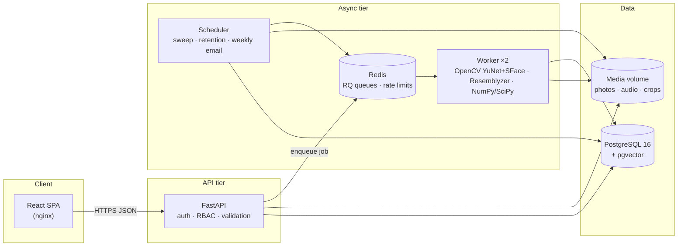

# SnapClass — System Design

> How to read this document: it follows the order of a system-design interview —
> **problem → requirements → estimates → architecture → data → trade-offs → scaling → failures → security**.
> Details live in [HLD.md](HLD.md) (components and flows) and [LLD.md](LLD.md) (code, tables, APIs, algorithms).
>
> **Numbers policy:** every capacity or latency number below is an **estimate or design target**
> unless it is explicitly marked *measured*. Accuracy has **not** been measured yet (see §13).

---

## 1. Problem

Taking attendance by calling names in a class of 60–120 students costs several minutes per lecture
and allows **proxy attendance** (a friend answers "present" for an absent student).

**SnapClass** lets a teacher take **1–10 photos of the classroom** (optionally a short roll-call
recording). A background worker finds every face, compares it **only with the students enrolled
in that class**, and proposes *Present / Not sure / Not found* for each student. The **teacher
reviews and saves**. Nothing becomes attendance without that human confirmation.

### Goals
1. Cut the teacher's effort to about a minute per lecture (target, not measured).
2. **Never silently mark a wrong student present**: unsure matches always go to a human.
3. Be built like a real service: async processing, audit trail, privacy controls, tests, Docker.

### Non-goals (deliberately out of scope)
- **Liveness / anti-spoofing** (detecting a printed photo). Mitigation: the teacher's own device
  takes the photo in class and the teacher reviews every result.
- Students marking themselves from their phones.
- Multi-college tenancy, ERP integration (decided against: SnapClass is standalone — see
  [design/erp-video-reenroll-design.md](design/erp-video-reenroll-design.md), kept as a rejected decision record).

---

## 2. Users (actors)

| Actor | What they do | Device |
|---|---|---|
| **Teacher** | Creates classes, invites students, takes class photos, reviews and saves attendance, corrects with a reason, asks a student for a new face photo, downloads reports | Phone or laptop, in class |
| **Student** | Registers with student ID, joins classes by QR/link, gives consent, enrolls face (+ optional voice), sees attendance per subject, can erase biometric data | Phone |
| **Admin** | Adds teachers, turns accounts on/off, changes retention and (technical) matching thresholds, reads the audit log and health dashboard | Laptop |
| **Worker** (system) | Runs face/voice matching and enrollment jobs from a queue | Container |
| **Scheduler** (system) | Re-queues stuck jobs, deletes old media, sends weekly emails | Container |

---

## 3. Functional requirements

| # | Requirement |
|---|---|
| F1 | **Accounts:** students self-register with student ID + name + password and sign in with the student ID; teachers/admin sign in with email. JWT access token (15 min) + rotating refresh token (7 days). |
| F2 | **Roles (RBAC):** Admin, Teacher (own classes only), Student (own data only). |
| F3 | **Classes:** teacher creates a class (subject, section, semester, minimum %), creates an invite link + QR code (expires in 72 h), removes students. |
| F4 | **Join:** a signed-in student joins a class with the invite code. |
| F5 | **Consent:** versioned consent text must be accepted before any biometric upload. |
| F6 | **Face enrollment:** 3–5 selfies → quality checks (exactly one face, ≥ 80 px, not blurry) → 128-number embeddings; selfies deleted right after. |
| F7 | **Voice enrollment (optional):** 3 clips → speech check (≥ 3 s) → 256-number embeddings. |
| F8 | **Take attendance:** teacher creates a lecture (date + period), uploads 1–10 photos and/or one audio clip. |
| F9 | **Async matching:** checking runs in a background job; the page polls for status. |
| F10 | **Matching rules:** compare only with the class roster; one face ↔ at most one student; each student gets PRESENT / UNCERTAIN / NOT_DETECTED. |
| F11 | **Review:** teacher sees face crops, can set Present/Absent, must decide every "Not sure"; can **add or remove photos and check again** before saving (own choices are kept). |
| F12 | **Save (finalize):** writes attendance records + audit entry in one transaction. |
| F13 | **Corrections:** after saving, a change needs a reason and is audited. |
| F14 | **Face photo requests:** teacher asks a student for a new face photo; until the student uploads, they are **not marked present automatically**; the request closes itself when new photos are accepted. |
| F15 | **Reports:** attendance % per student, date filter, below-minimum filter, CSV export. |
| F16 | **Student view:** attendance per subject, full history, "attend the next N classes to reach 75%". |
| F17 | **Privacy:** erase own biometrics at any time (attendance history kept); retention job deletes class media N days after saving. |
| F18 | **Admin:** teachers, settings, health metrics, audit log. |

---

## 4. Non-functional requirements (targets)

| Category | Target | How it is (or would be) verified |
|---|---|---|
| API latency | p95 < 200 ms for non-ML endpoints at 50 concurrent users | Locust script in `backend/load/` (not run yet) |
| Matching latency | p95 < 20 s from "Check attendance" to review, 60 students, 4 photos | `processing_ms` per lecture, p50/p95 on the admin dashboard |
| Burst | 100 lectures starting within 10 minutes (period change) without failures | Queue + 2–3 workers (estimate in §5) |
| Accuracy | Face FAR ≤ 1 % with FRR ≤ 10 %, threshold chosen on validation data | `backend/eval/evaluate.py` (needs a consented dataset) |
| Availability | 99 % during teaching hours; single region acceptable | Health checks `/healthz`, `/readyz` |
| Durability | Saved attendance never lost | Postgres + daily backups (deployment task) |
| Security | OWASP Top-10 basics, rate-limited login, no IDOR | Automated tests (IDOR → 404, RBAC → 403) |
| Privacy | Consent, minimum data, erasure, retention | Tests: erasure keeps attendance; retention deletes media |
| Usability | Usable by non-technical teachers; accessible (text size, contrast, keyboard) | HCI design notes [design/ux-hci.md](design/ux-hci.md); usability study planned |
| Portability | `docker compose up` runs the whole system | README |

---

## 5. Capacity estimation (back-of-the-envelope)

Assumptions (from the project spec): **5,000 students, 200 teachers, 1,000 lectures/day**.

**Embeddings (tiny)**
- Face: 5,000 students × 5 samples × 128 floats × 4 bytes ≈ **12.8 MB**
- Voice: 5,000 × 3 × 256 × 4 B ≈ **15.4 MB**
- → Fits in Postgres **and** in RAM. No separate vector database is needed.

**Class media (the main storage cost)**
- Photos are resized in the browser to a 2048 px long side, ≈ 1 MB each.
- Average 3 photos/lecture: 1,000 × 3 × 1 MB ≈ **3 GB/day** → × 7-day retention ≈ **21 GB**.
- Worst case 10 photos/lecture: ≈ 10 GB/day → ≈ 70 GB with 7-day retention.

**Compute**
- Face detection + embedding ≈ 0.1–0.5 s per photo on one CPU core (*one measurement on a synthetic
  2048×1536 image: 0.36 s for detection; real classroom photos with many faces will be slower — measure*).
- A 4-photo lecture ≈ a few seconds. A burst of 100 lectures × ~10 s = 1,000 CPU-seconds in 10 minutes
  → **2–3 worker processes** clear it. **Queue depth** is the scaling signal.

**Matching cost per lecture**
- ≤ 10 photos × ~10 faces × 120 students × 5 samples ≈ 60,000 distance computations → **microseconds in NumPy**.
- **Design consequence:** the vector index is *not* on the hot path. Per-class matching is a small
  in-memory NumPy problem; pgvector's HNSW index is used only for the cross-institution
  *duplicate-account check* at enrollment.

**Traffic**
- 1,000 lectures/day ≈ 1 lecture every ~30 s on average, peaks at period changes. Polling every
  2 s while processing ≈ a few requests/second at peak → one API instance is plenty.

---

## 6. High-level architecture (summary)

Full component descriptions, deployment and sequence diagrams: **[HLD.md](HLD.md)**.

---

## 7. API overview

REST under `/api/v1`, JSON, one error format:
`{"error": {"code": "NOT_FOUND", "message": "...", "request_id": "..."}}`.

| Area | Main endpoints |
|---|---|
| Auth | `POST /auth/register`, `/auth/login`, `/auth/refresh`, `/auth/logout`, `GET /auth/me` |
| Classes (teacher) | `POST/GET /classes`, `POST /classes/{id}/join-codes`, `GET /classes/{id}/students`, `POST /classes/{id}/sessions`, `GET /classes/{id}/report` |
| Join (student) | `GET /join/{code}` (public info), `POST /join/{code}` |
| Lectures (teacher) | `POST /sessions/{id}/media`, `DELETE /sessions/{id}/media/{mid}`, `POST /sessions/{id}/process`, `GET /sessions/{id}`, `PATCH .../results/{sid}`, `POST .../finalize`, `PATCH .../attendance/{sid}` |
| Face requests (teacher) | `POST/DELETE /classes/{id}/students/{sid}/face-update-request` |
| Student self-service | `GET /consent/current`, `POST /consent`, `POST /me/biometrics/face|voice`, `DELETE /me/biometrics`, `GET /me/attendance` |
| Admin | `GET /admin/metrics`, `/admin/teachers`, `/admin/settings`, `/admin/audit` |
| Ops | `GET /healthz`, `/readyz`, `/metrics` |

All 44 routes with request/response shapes: **[LLD.md §5](LLD.md#5-api-contract)**.

---

## 8. Data model (summary)

18 PostgreSQL tables. The most important idea is built **into the schema**:

- `match_results` = the AI's **proposal** (one row per student per lecture).
- `attendance_records` = the **truth**, written **only** when the teacher saves.

Keeping them in separate tables makes the human-in-the-loop guarantee structural, not just a UI rule.

Other key tables: `users`, `classes`, `enrollments`, `sessions` (one lecture, with a status
state machine), `session_media`, `face_embeddings` (`vector(128)` + HNSW index),
`voice_embeddings` (`vector(256)`), `consents`, `face_update_requests`, `audit_log`.
ER diagram and every column: **[LLD.md §4](LLD.md#4-data-model)**.

---

## 9. Key design decisions and trade-offs

| # | Decision | Why | Trade-off accepted |
|---|---|---|---|
| D1 | **Matching in a job queue (Redis + RQ)**, not inside the HTTP request | ML takes seconds; it would block API workers. Queue gives retries, back-pressure and independent scaling | More moving parts (Redis, worker, polling) |
| D2 | **RQ instead of Celery** | Redis-only, simple, enough for this scale | Fewer features (no complex routing/chords) |
| D3 | **Roster-restricted matching** (≤ 120 people, not 5,000) | False accepts grow with the size of the gallery you search | Cannot find a student who is in the wrong class (shown as "unknown face") |
| D4 | **One-to-one assignment (Hungarian algorithm)** per photo | Nearest-neighbour can give one student to two faces | Slightly more compute (still microseconds) |
| D5 | **Uncertainty band + human finalize** | A wrong "present" is worse than a few seconds of teacher time | Teacher must look at "Not sure" rows |
| D6 | **Voice alone is never PRESENT** | Voices are easy to replay and noisy in classrooms | Voice only helps when a face is also found |
| D7 | **Two short DB transactions around the slow ML work** | No row locks held during seconds of inference; re-checking the status makes jobs idempotent | Slightly more code |
| D8 | **pgvector in Postgres, no separate vector DB** | Embeddings total ~30 MB; one database = transactions + simpler ops | Would revisit at millions of vectors |
| D9 | **Uploads through the API to a local volume** (spec suggested S3 presigned URLs) | Simpler local setup; `LocalStorage` has the same interface an `S3Storage` would | Large files pass through the API (fine at ≤ 10 × 1 MB) |
| D10 | **OpenCV YuNet + SFace** (spec suggested dlib) | `pip install` only, no C++ build tools; CNN detector finds smaller faces than dlib HOG | Different thresholds — must be tuned |
| D11 | **Photos can change until saving; teacher choices are kept on re-check** | Teachers notice missing students during review | State machine has more transitions (tested) |
| D12 | **Face photo request blocks automatic PRESENT, not manual** | Old selfies are untrusted, but software must never force a present student absent | Teacher can still override (by design) |
| D13 | **Standalone accounts (no ERP)** | Author's decision; ERP access not available | Student-ID squatting risk (§12) |

---

## 10. Scaling path

| Load | What changes |
|---|---|
| **Today** (1 college) | 1 API, 2 workers, 1 Postgres, 1 Redis, local volume — all on one machine with Docker Compose |
| **×10** (10 colleges, 10,000 lectures/day) | Move media to **S3** (presigned uploads, lifecycle rules). Run API replicas behind a load balancer (API is stateless). **Autoscale workers on queue depth.** Managed Postgres with a read replica for reports |
| **×100** | Tenant ID on every table + per-tenant isolation; partition `attendance_records`/`audit_log` by month; separate queues per priority; GPU or batched inference for faces; CDN for the static frontend |

Things that **do not** need to change: per-class matching stays roster-bound (≤ 120 people), so the
hot path does not grow with total students. Embeddings for 50,000 students are still only ~130 MB.

---

## 11. Reliability and failure modes

| Failure | Effect | Handling |
|---|---|---|
| Worker crashes mid-job | Lecture stuck in PROCESSING | RQ retries 3× (10 s, 30 s, 60 s); scheduler re-queues lectures stuck > 10 min |
| Job fails after all retries | Teacher waits forever | `on_failure` callback marks FAILED (only after the **last** retry); teacher sees "Check again" |
| Duplicate / late job | Results written twice | Fixed job id `match-{session_id}` + status re-check inside a row lock → second run is a no-op |
| Redis down | Cannot queue | API returns 503 "queue unavailable" and restores the status; login rate limit fails open (logged) |
| Uploaded file missing/changed | Job would crash | SHA-256 verified before queueing |
| Bad photos (dark, far) | Many "Not found" | Warning on the review screen; teacher adds photos and checks again |
| Teacher saves by mistake | Wrong records | Correction with reason, audited |
| Model upgrade | Old/new embeddings incompatible | `model_ver` stored on embeddings; matching uses only the current version |
| API container restarts | nginx keeps the old IP → 502 | nginx re-resolves Docker DNS every 10 s (bug found and fixed in testing) |

---

## 12. Security and privacy

| Threat | Control |
|---|---|
| Password guessing | bcrypt (cost 12); login rate limit 5/min per IP + 10/hour per account (Redis); same error for unknown user and wrong password, and a dummy bcrypt check for unknown users so both cases take the same time |
| Token theft | 15-min access JWT; 7-day refresh token stored as SHA-256 hash, **rotated on every use**; reuse of a revoked token revokes **all** of the user's tokens |
| IDOR (teacher reads another class) | Every query scoped by `teacher_id`; foreign ids return **404**, not 403 (tested) |
| Malicious uploads | Size limits (photo 8 MB, audio 10 MB); type checked by **magic bytes**, not file name; decoded only in the worker |
| Biometric leak | Embeddings never returned by any API; face crops/photos served only via **5-minute HMAC-signed URLs**; enrollment selfies deleted right after embedding |
| Over-retention | Retention job deletes class media and crops N days (default 7) after saving |
| Consent | Versioned consent required before upload; withdrawing = deleting all biometric data; attendance history kept |
| Proxy attendance | Roster-only matching, one face ↔ one student, human review, duplicate-face check at enrollment (audit flag) |
| CSV injection | Cells starting with `= + - @` are escaped in exports |
| **Open risk: student-ID squatting** | Anyone can register any student ID first. Mitigations today: teacher sees/removes roster entries, admin can disable accounts. Next step: teacher-uploaded official roster (allow-list) |
| **Open risk: tokens in localStorage** | Readable by XSS; React escaping and no `dangerouslySetInnerHTML` reduce risk; next step: refresh token in an httpOnly cookie |

Legal note: biometric data is sensitive personal data under India's **DPDP Act, 2023**. The consent
text in `scripts/seed.py` is a template and must be reviewed before real use.

---

## 13. Observability

- **Logs:** JSON lines with `request_id`, `user_id`, route, status, latency (every request).
- **Request ID:** `X-Request-ID` header in and out; shown in every error body.
- **Metrics:** Prometheus `/metrics` (request count + latency histogram per route template).
- **Business metrics:** admin dashboard — lectures by status, failed jobs, queue depth, match time p50/p95.

### What has been measured vs not
| Item | Status |
|---|---|
| Automated tests | **72 passing** (unit, API, worker) — *measured* |
| End-to-end smoke test `backend/smoke/smoke_e2e.py` (synthetic images/audio through nginx → API → Redis → worker → DB, real models) | **25/25 checks passing** — *measured* |
| Worker cold start | First voice embedding took **18 s** (librosa JIT) → fixed with warm-up; same job then **0.41 s** — *single measurement, dev machine, synthetic data* |
| Face accuracy (FAR/FRR/EER) | **Not measured** — needs a consented dataset (`backend/eval/`) |
| API p95 latency, burst throughput | **Not measured** — Locust script exists |
| Usability (SUS score, task time) | **Not measured** — study plan in [design/ux-hci.md](design/ux-hci.md) |
